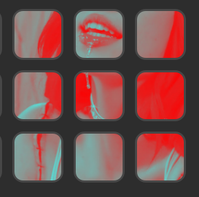
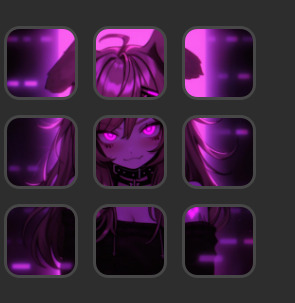

# YTMD Art Tiles

A Stream Deck plugin that spreads the current [YouTube Music Desktop](https://ytmdesktop.app/) album art across a block of keys, so the cover shows up as one big picture. Supports 2x2 and 3x3 blocks and compensates for the gaps between keys.

## Examples

3x3 blocks on a Stream Deck:

<p>
  
  
</p>

## Requirements

- Stream Deck software 7.1 or newer (Windows)
- YouTube Music Desktop with the companion server enabled

## Setup

1. In YouTube Music Desktop, open **Settings > Integrations** and turn on **Companion server** and **Enable companion authorization**.
2. Install the plugin (double-click the `.streamDeckPlugin` file from the releases page).
3. Drag **Album Art Tile** onto each key of a 2x2 or 3x3 block.
4. Click each key and set **Grid size**, **Row** and **Column** to match where that key sits in the block.
5. Play a song. Click **Allow** when YouTube Music Desktop asks to authorize "Stream Deck Art Tiles". This only happens once.

Pressing any tile toggles play/pause.

## Troubleshooting

- **Keys stay blank:** make sure YouTube Music Desktop is running and a song is loaded, and that companion authorization is on. Pairing requests are rate-limited, so the plugin retries once a minute.
- **Picture looks stretched or broken at the gaps:** adjust `GAP` in `src/tiles.ts` and rebuild.
- Plugin logs are in `com.birdtruther.ytmd-art-tiles.sdPlugin/logs`.

## Building from source

Requires Node.js 20 or newer and the [Stream Deck CLI](https://docs.elgato.com/streamdeck/cli/intro).

```bash
npm install
npm run build
streamdeck link com.birdtruther.ytmd-art-tiles.sdPlugin
```

To produce an installable file: `streamdeck pack com.birdtruther.ytmd-art-tiles.sdPlugin`.

## License

MIT
